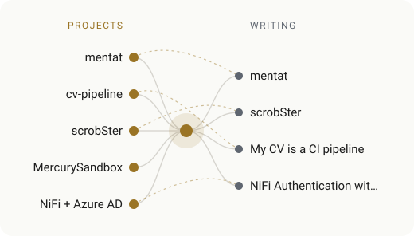

<a href="https://github.com/benkelly/now-playing-card">
<picture>
  <source media="(prefers-color-scheme: dark)" srcset="https://music.idk.ie/now.svg?theme=dark">
  
</picture>
</a>

## Hi, I'm ben

Platform engineer in Dublin. I build infrastructure that's secure by default and easy to live with.

- Six years at **Microsoft Azure**: helped stand up two US sovereign clouds, turned EU data law into architecture for the EU Data Boundary, and ran build and deploy tooling for 100+ Azure Core repos.
- Most recently **lead platform engineer** at a smart-building startup: AWS, Kubernetes (EKS), Terraform, PKI and just-in-time access.
- Co-inventor on two US patent applications. Started out as an electrician's apprentice at 15, so I like hardware too.
- I'm also Dyslexic. I like to write about making tools and documents that work for people like me.

[CV](https://cv.benjamin.ie) · [LinkedIn](https://www.linkedin.com/in/b3nkelly/) · [Blog](https://blog.benjamin.ie) · [Consulting](https://consulting.benjamin.ie)

### Things I've built

| | |
| --- | --- |
| [**mentat-template**](https://github.com/benkelly/mentat-template) | A private knowledge base your AI tools share. Markdown notes served to Claude and OpenCode over MCP from a Cloudflare Worker, with GitHub sign-in for one account. [Post](https://blog.benjamin.ie/blog/mentat) · [Live demo](https://mentat-demo.idk.ie/graph) |
| [**cv-pipeline**](https://github.com/benkelly/cv-pipeline) | My CV as code. One LaTeX file builds accessible, dyslexia-friendly and high-contrast PDFs, plus Markdown and JSON, with a preview for every pull request. [Post](https://blog.benjamin.ie/blog/my-cv-is-a-ci-pipeline) |
| [**scrobSter**](https://github.com/benkelly/scrobster) | Identifies the music playing in every room from mics and cameras, and scrobbles it to Last.fm, ListenBrainz and Maloja. [Post](https://blog.benjamin.ie/blog/scrobster) |
| [**MercurySandbox**](https://github.com/benkelly/MercurySandbox) | A self-hosted AI coding-agent stack in sandboxed Docker containers. |

<picture>
  <source media="(prefers-color-scheme: dark)" srcset="assets/map-dark.svg">
  
</picture>

### Latest writing

<!-- BLOG-POSTS:START -->
- [mentat: one memory for all my AI tools](https://blog.benjamin.ie/blog/mentat) · 04 Nov 2026
- [scrobSter: scrobbling the music in every room](https://blog.benjamin.ie/blog/scrobster) · 01 Nov 2026
- [My CV is a CI pipeline](https://blog.benjamin.ie/blog/my-cv-is-a-ci-pipeline) · 30 Sep 2024
- [NiFi Authentication with Azure Active Directory](https://blog.benjamin.ie/blog/nifi-azure-ad-authentication) · 08 Nov 2022
<!-- BLOG-POSTS:END -->

### Latest gists

<!-- GISTS:START -->
- [Shelly Smart Bulb Control with Fallback](https://gist.github.com/benkelly/f52bb7b286ced37324c7c2603aa54f29) · 15 Mar 2026
- [Some notes and tools for reverse engineering / deobfuscating / unminifying obfuscated web app code](https://gist.github.com/benkelly/311116b317e2fea20a5e7295094e2940) · 13 Mar 2025
- [Tesla Key Card Protocol](https://gist.github.com/benkelly/ef02ffa59ea272a1260d3399cbf24f4b) · 08 Oct 2024
- [covid_improved.rb](https://gist.github.com/benkelly/65b0a2c1c36594a522b2dbe3ad2edeb0) · 17 Mar 2020
<!-- GISTS:END -->

### Recently active

<!-- REPOS:START -->
| Repo | What | Pushed |
| --- | --- | --- |
| [sidepulse-mqtt](https://github.com/benkelly/sidepulse-mqtt) | Show SidePulse agent status and LEDs in Home Assistant over MQTT, and control the LEDs. Python | 13 Nov 2026 |
| [opencode-sidepulse](https://github.com/benkelly/opencode-sidepulse) | Show opencode agent status on a SidePulse Pro or Dot LED device. JavaScript | 13 Nov 2026 |
| [ha-addons](https://github.com/benkelly/ha-addons) | Home Assistant add-ons Shell | 13 Nov 2026 |
| [mentat-template](https://github.com/benkelly/mentat-template) | Read more about mentat: https://blog.benjamin.ie/mentat TypeScript | 13 Nov 2026 |
| [legocam](https://github.com/benkelly/legocam) | macOS user-space driver for the 1999 LEGO Studios camera (Logitech QuickCam Web). Use it as a webcam. C | 10 Nov 2026 |
<!-- REPOS:END -->

The map and lists update themselves every few hours from my blog and GitHub ([scripts/build_profile.py](scripts/build_profile.py)). The music card is live, drawn by [now-playing-card](https://github.com/benkelly/now-playing-card) from Last.fm, fed by scrobSter.
